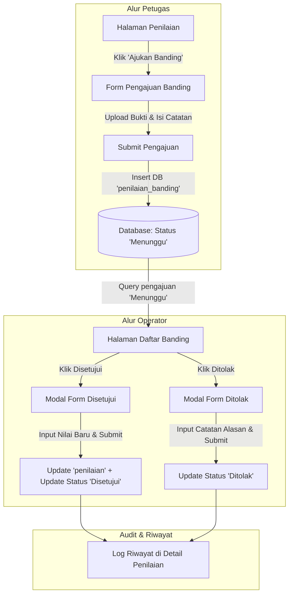

# Implementation Plan: Pengajuan Banding Nilai Petugas

Dokumen ini merinci rencana teknis implementasi fitur **Pengajuan Banding Nilai** berdasarkan spesifikasi pada [`aju_banding.md`](aju_banding.md).

---

## Deskripsi Fitur & Arsitektur

Fitur ini memungkinkan **Petugas** mengajukan permohonan banding atas penilaian kinerja bulanan yang telah diterbitkan, dengan menyertakan catatan penjelasan serta bukti dokumen/foto pendukung. **Operator** kemudian dapat meninjau daftar pengajuan yang berstatus *Menunggu*, lalu menyetujui pengajuan (dengan memperbarui skor penilaian pada 3 komponen) atau menolaknya (dengan memberikan catatan penolakan wajib).



---

## User Review Required

> [!IMPORTANT]
> **Poin Konfirmasi Alur & Desain:**
> 1. **Status Penolakan**:
>    Pada spec tabel tertulis `enum('Menunggu', 'Disetujui', 'Ditangguhkan')`, namun di alur UI tertulis tombol "Ditolak". Di rencana ini, kita definisikan enum/check constraint mendukung: `'Menunggu'`, `'Disetujui'`, `'Ditangguhkan'`, `'Ditolak'`. Tombol tolak akan menetapkan status `'Ditolak'`.
> 2. **Batas Pengajuan Banding**:
>    Untuk mencegah spam pengajuan berulang saat pengajuan sebelumnya masih diproses, sistem akan memvalidasi agar satu penilaian **tidak dapat mengajukan banding baru jika masih ada banding berstatus 'Menunggu'**.
> 3. **Akses Masuk Petugas**:
>    Petugas dapat mengakses halaman form banding langsung melalui tombol/aksi "Banding" pada baris penilaian di tabel `PenilaianListPage.tsx` atau melalui modal Detail Penilaian.

---

## Proposed Changes

### 1. Backend & Database (Supabase)

#### [NEW] `backend/backend/supabase/migrations/00018_create_penilaian_banding.sql`
Membuat tabel `penilaian_banding`, index, check constraint, RLS policies, dan storage bucket untuk lampiran banding.

- **Definisi Tabel:**
  ```sql
  CREATE TABLE penilaian_banding (
      id UUID PRIMARY KEY DEFAULT gen_random_uuid(),
      id_penilaian UUID NOT NULL REFERENCES penilaian(id) ON DELETE CASCADE,
      catatan_petugas TEXT NOT NULL,
      catatan_operator TEXT,
      lampiran_url VARCHAR(500),
      status VARCHAR(20) NOT NULL DEFAULT 'Menunggu' 
          CHECK (status IN ('Menunggu', 'Disetujui', 'Ditangguhkan', 'Ditolak')),
      created_at TIMESTAMPTZ DEFAULT NOW(),
      reviewed_at TIMESTAMPTZ,
      CONSTRAINT cek_catatan_operator_wajib CHECK (
          (status = 'Menunggu') OR 
          (status != 'Menunggu' AND catatan_operator IS NOT NULL AND length(trim(catatan_operator)) > 0)
      )
  );

  CREATE INDEX idx_penilaian_banding_penilaian ON penilaian_banding(id_penilaian);
  CREATE INDEX idx_penilaian_banding_status ON penilaian_banding(status);
  ```

- **RLS Policies (`penilaian_banding`):**
  - **Petugas INSERT**: Hanya boleh insert jika `id_penilaian` dimiliki oleh petugas yang sedang login (`mp.email = auth.jwt() ->> 'email'`).
  - **Petugas SELECT**: Hanya boleh membaca banding milik penilaian dirinya.
  - **Operator SELECT**: Boleh membaca semua pengajuan banding (`role_id = 2`).
  - **Operator UPDATE**: Boleh mengupdate status, catatan_operator, dan reviewed_at (`role_id = 2`).
  - **Kepala Sesi SELECT**: Boleh membaca seluruh data untuk monitoring/rekap (`role_id = 3`).

- **Storage Bucket (`penilaian-lampiran`):**
  - Bucket name: `penilaian-lampiran` (public = true, limit = 10MB, mime: `image/jpeg`, `image/png`, `application/pdf`).
  - Storage policy upload & read bagi user terotentikasi.

---

### 2. Konfigurasi, Tipe Data & Constants (Frontend)

#### [MODIFY] `src/lib/constants.ts`
- Perbarui URL route:
  - `PENILAIAN_BANDING: '/penilaian/banding'` (Halaman daftar peninjauan operator)
  - `PENILAIAN_AJU_BANDING: '/penilaian/:id/banding'` (Halaman form pengajuan petugas)
- Tambahkan konstanta status:
  ```typescript
  export const STATUS_BANDING = {
    MENUNGGU: 'Menunggu',
    DISETUJUI: 'Disetujui',
    DITANGGUHKAN: 'Ditangguhkan',
    DITOLAK: 'Ditolak',
  } as const;
  ```

#### [MODIFY] `src/lib/supabase.ts`
- Tambahkan bucket lampiran ke `STORAGE_BUCKETS`:
  ```typescript
  export const STORAGE_BUCKETS = {
    FOTO_TUGAS: 'tugas-foto',
    LAMPIRAN_CUTI: 'cuti-lampiran',
    LAMPIRAN_BANDING: 'penilaian-lampiran',
  } as const;
  ```

#### [MODIFY] `src/types/index.ts`
- Definisikan tipe dan interface:
  ```typescript
  export type StatusBanding = 'Menunggu' | 'Disetujui' | 'Ditangguhkan' | 'Ditolak';

  export interface PenilaianBanding {
    id: string;
    id_penilaian: string;
    catatan_petugas: string;
    catatan_operator?: string | null;
    lampiran_url?: string | null;
    status: StatusBanding;
    created_at: string;
    reviewed_at?: string | null;
    penilaian?: Penilaian;
  }

  export interface PenilaianBandingFormData {
    catatan_petugas: string;
    lampiran?: File;
  }

  export interface PenilaianDetail extends Penilaian {
    banding?: PenilaianBanding[];
  }
  ```

---

### 3. Data Hooks (React Query & Supabase)

#### [NEW] `src/hooks/usePenilaianBanding.ts`
- `usePenilaianBandingList(status?: StatusBanding)`: Mengambil daftar banding (dengan join data penilaian dan data petugas).
- `usePenilaianBandingByPenilaian(idPenilaian: string)`: Mengambil log riwayat banding untuk penilaian tertentu.
- `useCreateBanding()`:
  - Mengunggah file ke storage `penilaian-lampiran` jika ada.
  - Insert row ke `penilaian_banding`.
  - Invalidate cache query `penilaian` dan `penilaian_banding`.
- `useApproveBanding()`:
  - Memperbarui 3 skor di tabel `penilaian` (`skor_displin_kehadiran`, `skor_tanggung_jawab`, `skor_kepatuhan`).
  - Memperbarui status di `penilaian_banding` menjadi `'Disetujui'`, mengisi `catatan_operator` dan `reviewed_at = NOW()`.
- `useRejectBanding()`:
  - Memperbarui status di `penilaian_banding` menjadi `'Ditolak'`, mengisi `catatan_operator` (wajib) dan `reviewed_at = NOW()`. Nilai di `penilaian` tetap sama.

---

### 4. Komponen Fitur Penilaian Banding

#### [NEW] `src/components/features/penilaian/ModalApproveBanding.tsx`
- Modal form saat Operator klik tombol hijau (check):
  - Menampilkan skor awal (disabled).
  - Menampilkan catatan petugas (disabled).
  - Thumbnail lampiran yang bisa diklik untuk preview.
  - Input perubahan skor (Disiplin Kehadiran, Tanggung Jawab, Kepatuhan) dengan validasi `min(0).max(100)`.
  - Input opsional catatan operator.
  - Tombol Submit Simpan & Batal.

#### [NEW] `src/components/features/penilaian/ModalRejectBanding.tsx`
- Modal form saat Operator klik tombol merah (X):
  - Menampilkan skor awal & catatan petugas (disabled).
  - Thumbnail lampiran.
  - Input Textarea Catatan Penolakan (Wajib diisi).
  - Tombol Submit Tolak & Batal.

#### [NEW] `src/components/features/penilaian/ModalLampiranPreview.tsx`
- Modal preview dokumen file gambar (JPG/PNG) atau tautan/preview dokumen PDF.

#### [NEW] `src/components/features/penilaian/PenilaianDetailModal.tsx`
- Modal untuk Petugas/Operator melihat rincian penilaian beserta log timeline pengajuan banding (status, catatan petugas, catatan operator, waktu diajukan, waktu ditinjau).

---

### 5. Halaman & Routing

#### [NEW] `src/pages/PenilaianAjuBandingPage.tsx`
- Halaman form pengajuan untuk Petugas:
  - Header & tombol kembali ke `/penilaian`.
  - Card ringkasan skor penilaian saat ini (Disiplin, Tanggung Jawab, Kepatuhan, Total).
  - Form Zod:
    - Textarea `catatan_petugas` (wajib).
    - File Dropzone `lampiran` (JPG, PNG, PDF max 10MB).
  - Submit mutation dan notifikasi toast sukses/gagal.

#### [NEW] `src/pages/PenilaianBandingPage.tsx`
- Halaman pengajuan banding untuk Operator:
  - Menampilkan header dengan info jumlah pengajuan yang menunggu.
  - Tabel pengajuan: Nama Petugas, Periode, Skor Awal 3 Komponen, Catatan Pengajuan (elipsis), Tombol Preview Lampiran, Waktu Pengajuan.
  - Kolom Aksi: Tombol Approve (icon check, hijau) & Tombol Reject (icon X, merah).
  - Terintegrasi dengan ModalApproveBanding, ModalRejectBanding, dan ModalLampiranPreview.

#### [MODIFY] `src/pages/PenilaianListPage.tsx`
- Tambahkan tombol navigasi "Pengajuan Banding" di `PageHeader` khusus role `Operator` (dengan badge hitungan banding berstatus *Menunggu*).
- Pada baris tabel:
  - Tambahkan tombol "Detail & Riwayat" untuk melihat log banding.
  - Untuk Petugas: tombol "Ajukan Banding" yang mengarahkan ke `/penilaian/:id/banding` (dinonaktifkan jika sudah ada banding berstatus *Menunggu*).

#### [MODIFY] `src/routes/index.tsx`
- Daftarkan lazy import `PenilaianAjuBandingPage`.
- Hubungkan route:
  - `ROUTES.PENILAIAN_BANDING` dibungkus `<RoleGate roles={[ROLE_CODES.OPERATOR]}>`
  - `ROUTES.PENILAIAN_AJU_BANDING` dibungkus `<RoleGate roles={[ROLE_CODES.PETUGAS]}>`

---

## Verification Plan

### Automated Tests & Lint
1. Menjalankan typecheck TypeScript:
   ```powershell
   npm run build
   ```
2. Memastikan tidak ada compile error pada routing, hook, dan komponen baru.

### Manual Verification
1. **Login sebagai Petugas:**
   - Buka menu Penilaian (`/penilaian`).
   - Verifikasi adanya tombol "Ajukan Banding" pada baris nilai.
   - Klik "Ajukan Banding" -> diarahkan ke `/penilaian/:id/banding`.
   - Periksa apakah skor awal tampil sesuai.
   - Isi catatan pengajuan dan unggah file bukti (gambar atau PDF).
   - Klik Submit -> notifikasi sukses muncul, kembali ke daftar nilai.
   - Buka modal detail penilaian -> pastikan log pengajuan muncul dengan status "Menunggu".
2. **Login sebagai Operator:**
   - Buka menu Penilaian -> periksa tombol "Pengajuan Banding" dengan badge notifikasi jumlah pending.
   - Klik tombol -> masuk ke `/penilaian/banding`.
   - Periksa daftar tabel pengajuan banding.
   - Klik preview lampiran -> pastikan dokumen/gambar terbuka di modal preview.
   - Test Penolakan: Klik tombol merah (X) -> isi catatan penolakan -> submit -> item hilang dari list utama -> cek detail penilaian nilai tidak berubah, log status "Ditolak".
   - Test Persetujuan: Ajukan banding baru -> klik tombol hijau (check) -> ubah skor -> submit -> item selesai ditinjau -> cek daftar penilaian nilai terupdate otomatis.
3. **Validasi Constraint:**
   - Coba submit review tolak tanpa mengisi catatan operator -> form menolak submit.
   - Coba isi skor di luar batas 0–100 -> form menolak submit.
